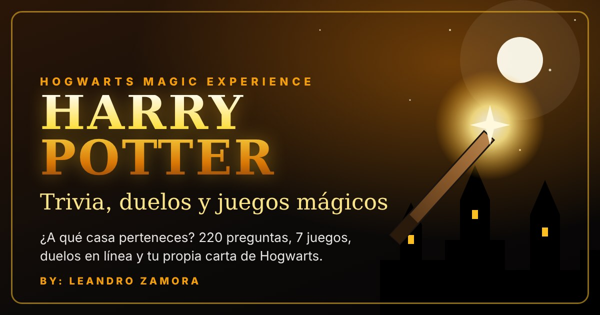

<div align="center">



# 🪄 Hogwarts Magic Experience

**Trivia, juegos, duelos en línea y magia de Harry Potter en una sola página web.**

[🌐 Ver demo](https://TU-PAGINA.vercel.app) · [📖 Manual de usuario](Manual_de_Usuario_Hogwarts.docx) · [🐛 Reportar un problema](../../issues)


</div>

---

## ✨ Características

| | |
|---|---|
| 🎩 **Ceremonia de Selección** | El Sombrero Seleccionador te asigna una casa con 7 preguntas, y toda la página toma sus colores. |
| 🎬 **Trivia de las 8 películas** | 220 preguntas: 25 por película más frases célebres y el Modo Maratón. Tiene dificultades, contrarreloj, comodín 50/50 y lectura en voz alta. |
| 🎲 **7 juegos** | Mapa del Merodeador, Clase de Pociones, Atrapa la Snitch, Adivina el Personaje, Ahorcado, Memoria y Quidditch. |
| ⚔️ **Duelos de magos** | Dos jugadores en el mismo dispositivo, contra una IA con 3 niveles o **en línea en tiempo real** con código de sala. |
| 🖌️ **Estudio de hechizos** | Dibuja hechizos con el dedo o el mouse; la página reconoce 5 trazos. |
| 🪄 **Ollivanders** | Crea tu varita eligiendo madera, núcleo, longitud y flexibilidad. |
| 📜 **Carta de Hogwarts** | Tu carta de aceptación personalizada, lista para imprimir o guardar en PDF. |
| 📚 **Biblioteca** | 25 personajes, 18 criaturas y la línea de tiempo de la saga, con buscador. |
| 🏆 **Ranking en línea** | Top 50 de jugadores guardado en Supabase. |
| 🛍️ **Tienda y progreso** | XP, 5 rangos, 28 logros, galeones, Copa de las Casas y desafío diario. |
| 🪪 **Tarjeta de mago** | Imagen PNG descargable con tus datos, para compartir en redes. |
| 🎵 **Música de fondo** | Lista de reproducción con controles y volumen que baja solo durante los duelos. |
| 📱 **App instalable (PWA)** | Se instala en el celular o la PC y funciona sin internet. |
| ♿ **Accesibilidad** | Letra grande, alto contraste, menos animaciones y teclado completo. |

## 🛠️ Tecnologías

- **HTML5 + JavaScript** sin frameworks: toda la página es un único `index.html`.
- **Tailwind CSS** para los estilos y **Font Awesome** para los íconos.
- **Canvas 2D** para los efectos, el cielo nocturno, la ruleta, la snitch y la tarjeta de mago.
- **SVG** animado para el Mapa del Merodeador, el caldero y los pósters.
- **Web Audio API**, **Speech Synthesis API** y **Media Session API** para el sonido, la voz y la música.
- **Supabase** (PostgreSQL con Row Level Security y Realtime) para el ranking y el duelo en línea.
- **Service Worker + Web App Manifest** para la PWA.
- **localStorage** para guardar el progreso de cada jugador.

## 📁 Estructura

```
├── index.html          # La aplicación completa
├── manifest.json       # Configuración de la PWA
├── sw.js               # Service worker (modo sin internet)
├── icon-192.png        # Íconos de la app
├── icon-512.png
├── og-image.jpg        # Vista previa al compartir el enlace
├── supabase.sql        # Script para crear el ranking en Supabase
├── musica1.mp3         # Música de fondo (agregar)
├── musica2.mp3
├── musica3.mp3
├── pelicula1-8.jpg     # Pósters propios (opcional)
└── dueloimagen.jpg     # Imagen del duelo (opcional)
```

## 🚀 Cómo usarlo

### Probarlo en tu computadora
Descarga el repositorio y abre `index.html` con doble clic. No hace falta instalar nada.

### Publicarlo en Vercel
1. Haz un fork o sube estos archivos a tu repositorio de GitHub.
2. En [vercel.com](https://vercel.com) elige **Add New → Project** e importa el repositorio.
3. Deja la configuración por defecto (es un sitio estático) y presiona **Deploy**.
4. En `index.html`, reemplaza `TU-PAGINA.vercel.app` por tu dirección real (líneas 22 y 23) y completa `SITE_URL` en `CONFIG`.

### Activar el ranking y el duelo en línea (opcional)
1. Crea un proyecto en [supabase.com](https://supabase.com).
2. En **SQL Editor**, ejecuta el contenido de [`supabase.sql`](supabase.sql).
3. En **Project Settings → API**, copia la *Project URL* y la clave *anon public*.
4. Pégalas en el objeto `CONFIG` de `index.html`:

```js
const CONFIG = {
  SUPABASE_URL: 'https://xxxx.supabase.co',
  SUPABASE_ANON_KEY: 'tu-clave-anon-public',
  SITE_URL: 'https://tu-pagina.vercel.app'
};
```

> 🔒 La clave *anon* es pública por diseño. La tabla está protegida con **Row Level Security**: nadie puede escribir directamente en ella, y la función `enviar_puntaje` solo deja que cada jugador actualice su propia fila. **Nunca** uses la clave `service_role` en el código.

## ⌨️ Atajos de teclado

| Tecla | Acción |
|---|---|
| `1` – `4` | Responder en la trivia, los duelos y el quidditch |
| `Enter` | Siguiente pregunta / entrar al castillo |
| `L` | Leer la pregunta en voz alta |
| `F` | Usar el comodín 50/50 |
| `A` – `Z` | Letras en el Ahorcado |
| `Esc` | Cerrar ventanas |

## 📸 Créditos

- Fotografías de locaciones de rodaje: [Geograph Britain and Ireland](https://www.geograph.org.uk), con licencia [CC BY-SA 2.0](https://creativecommons.org/licenses/by-sa/2.0/). El crédito de cada fotógrafo está dentro de la app, en **Perfil → Créditos de las fotografías**.
- Ilustraciones de los pósters, íconos y efectos: creados para este proyecto.

## ⚠️ Aviso

Proyecto de fans **sin fines comerciales**, creado con fines educativos. *Harry Potter* y todos sus nombres y personajes son marcas registradas de sus respectivos propietarios. Este proyecto no tiene relación con ellos ni cuenta con su respaldo.

---

<div align="center">

Hecho con 🪄 por **Leandro Zamora Cóndor** · Estudiante de Ingeniería de Sistemas, UPN

*«Travesura realizada.»*

</div>
